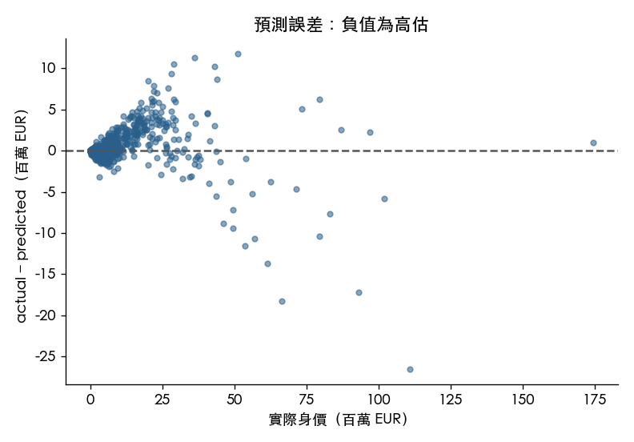

# 統計顯著性與錯誤案例分析

**本節接續 part 2 的既有結果，分析最終線性模型 Ours（OLS, Set C）與 strong baseline（Random Forest）。** 固定 training portion 為 14,724 筆，held-out test 為 3,681 筆。
模型使用 31 個 features，target 為 `log1p(value_eur)`；預測以 `expm1` 還原，再截在 training 身價範圍。以下使用組員已匯出的 test 預測，並重建同一個 OLS 核對係數。

## 模型比較（§7.1）

| Metric | Ours (OLS, Set C) | Strong (Random Forest) | RF 改善幅度 | 95% bootstrap CI | Bonferroni p |
|---|---:|---:|---:|---|---:|
| MAE (€K) | 365 | 155 | 210 | [168, 248] | < 0.001 |
| RMSLE | 0.160 | 0.078 | 0.082 | [0.063, 0.098] | < 0.001 |
| Within ±20% (%) | 85.8 | 98.2 | 12.4 | [11.3, 13.5] | < 0.001 |

**Held-out test 上，RF 的 MAE、RMSLE 與 Within ±20% 均較佳。** MAE／RMSLE 的改善幅度是 Ours − RF；Within ±20% 是 RF − Ours，差值單位為百分點。後者只包含身價 > 0 的 3,665 位球員。
MAE 使用每位球員 absolute loss 的 paired t-test；RMSLE 的 paired t-test 使用 squared log1p loss，CI 則直接 bootstrap RMSLE 差；Within ±20% 使用 exact McNemar。p-value 對三項指標檢定作 Bonferroni 校正，CI 為逐項區間。
這些推論假設球員獨立、模型固定。league cluster bootstrap 的敏感度結果保留在 [model_comparisons.csv](model_comparisons.csv)。±20% 門檻於 test 評估後決定，屬事後分析；它與「每位球員都符合某個 RMSLE 門檻」不是同一判準。

## 最終模型係數（§8.1）

以下 β 是 feature 增加 1 training SD 時，`log1p(value_eur)` 尺度的係數。CI 與 p-value 採 HC3；組員原本的係數表採 classical OLS，兩種方法均保留在 [coefficients_hc3.csv](coefficients_hc3.csv)。截距及 Bonferroni 校正結果另見同檔。

| Feature | β | HC3 95% CI | HC3 p | VIF |
|---|---:|---|---:|---:|
| `overall` | 0.9396 | [0.9248, 0.9543] | < 0.001 | 19.8 |
| `potential` | 0.3144 | [0.3024, 0.3264] | < 0.001 | 13.2 |
| `age` | -0.2380 | [-0.2485, -0.2276] | < 0.001 | 11.9 |
| `height_cm` | 0.0019 | [-0.0033, 0.0072] | 0.473 | 3.2 |
| `weight_kg` | -0.0028 | [-0.0078, 0.0022] | 0.269 | 2.9 |
| `weak_foot` | 0.0036 | [0.0002, 0.0071] | 0.040 | 1.2 |
| `skill_moves` | 0.0096 | [0.0038, 0.0155] | 0.001 | 3.5 |
| `international_reputation` | 0.1638 | [0.1443, 0.1834] | < 0.001 | 19.1 |
| `league_level` | 0.0021 | [-0.0005, 0.0046] | 0.112 | 1.1 |
| `contract_years_left` | 0.0052 | [0.0012, 0.0092] | 0.010 | 1.4 |
| `club_tenure_years` | 0.0007 | [-0.0033, 0.0047] | 0.717 | 1.1 |
| `pace` | 0.0026 | [-0.0079, 0.0132] | 0.627 | 11.1 |
| `shooting` | 0.0238 | [0.0125, 0.0352] | < 0.001 | 16.3 |
| `passing` | 0.0406 | [0.0238, 0.0574] | < 0.001 | 38.0 |
| `dribbling` | 0.0063 | [-0.0136, 0.0261] | 0.538 | 51.6 |
| `defending` | -0.0062 | [-0.0151, 0.0027] | 0.172 | 11.1 |
| `physic` | 0.0212 | [0.0089, 0.0335] | < 0.001 | 18.3 |
| `is_goalkeeper` | -0.0041 | [-0.0213, 0.0132] | 0.646 | 33.4 |
| `is_defender` | -0.0138 | [-0.0192, -0.0084] | < 0.001 | 3.1 |
| `is_forward` | 0.0121 | [0.0079, 0.0162] | < 0.001 | 2.6 |
| `left_footed` | -0.0008 | [-0.0038, 0.0022] | 0.607 | 1.1 |
| `real_face` | 0.0030 | [-0.0014, 0.0075] | 0.181 | 1.8 |
| `unique_body_type` | -0.0049 | [-0.0136, 0.0038] | 0.270 | 1.2 |
| `in_national_team` | -0.0014 | [-0.0061, 0.0033] | 0.555 | 1.4 |
| `on_loan` | -0.0011 | [-0.0036, 0.0015] | 0.403 | 1.2 |
| `overall_sq_centered` | 0.1255 | [0.1198, 0.1312] | < 0.001 | 2.2 |
| `age_sq_centered` | -0.2225 | [-0.2318, -0.2133] | < 0.001 | 2.9 |
| `overall_x_reputation` | -0.1531 | [-0.1706, -0.1357] | < 0.001 | 18.6 |
| `is_free_agent` | -1.0237 | [-1.0409, -1.0066] | < 0.001 | 1.2 |
| `age40_outfield` | -0.4200 | [-0.4472, -0.3928] | < 0.001 | 1.1 |
| `top5_league` | 0.0111 | [0.0067, 0.0154] | < 0.001 | 1.6 |

- **VIF：** 12 個 features 的 VIF > 10，與 part 2 一致；共線性會影響個別係數的解讀。
- **方法差異：** HC3 下有 13 個 features 的 p > 0.05，classical OLS 為 12 個。`unique_body_type` 的 p 從約 0.0024 變為 0.270，需在報告中明確標示使用哪種方法。
- **解讀：** 平方項與交互項須共同考慮。HC3 處理異質變異，但 CI／p 仍條件於既定模型與特徵選擇，不涵蓋 club／league 群聚；不顯著不等於沒有作用，係數也不代表因果效果。

### Part 1 假設的對照（H1、H2）

| Hypothesis | 移除的 features | CV RMSLE | 結果 |
|---|---|---|---|
| H1 (`overall`) | `overall`、`overall_sq_centered`、`overall_x_reputation` | 0.171 → 0.283 | 5/5 folds 均變差 |
| H2 (`international_reputation`) | `international_reputation`、`overall_x_reputation` | 0.171 → 0.175 | 5/5 folds 均變差 |

這與 part 2 對預測價值的解讀一致。因為 CV folds 的 training sets 重疊，這裡使用消融結果作描述性證據；不把五個 folds 當成五個獨立實驗。H1／H2 的整組 HC3 檢定也拒絕零係數（均 p < 0.001），完整結果見 [hypothesis_block_tests.csv](hypothesis_block_tests.csv)。這是條件關聯的檢定，與預測消融的問題不同。
消融數值直接引用 [組員的 CV 消融結果](../../linear/ablation/cv_summary.csv)，不採用其中的 fold paired t-test p-value。

`international_reputation` 的條件效果會隨 `overall` 改變，例如 `overall` = 80 時 +1 約對應 +8.5%，85 時約 −3.7%。局部 training 支持與完整有限對比見 [marginal_effects.csv](marginal_effects.csv)。

### EUR 尺度的實務意義

固定 `overall` = 70、`international_reputation` = 1、其他輸入不變，並假設參考預測為 €1M。共同計入平方項／交互項後，得到以下裁切前預測差：

| Feature +1 | 預測差 (€K) | HC3 95% CI (€K) | 與示例 €200K 門檻比較 |
|---|---:|---|---|
| `overall` | 165.6 | [162.8, 168.3] | 低於 |
| `international_reputation` | 379.2 | [325.5, 435.0] | 超過 |

兩個 CI 都排除零，但統計顯著不直接等於實務價值。€200K 是沿用事後 ±20% 的示例門檻，尚未驗證為使用者容忍度；上述情境也不是觀測到的實驗結果或因果效果。CI 固定參考預測，不包含其不確定性，也不代表 EUR 條件平均。€10M 情境與精確金額見 [practical_effects_eur.csv](practical_effects_eur.csv)。

## 錯誤案例分析（§8.2）

**依最終 OLS 的最大 absolute EUR error 選出三例。** 下表及圖使用 `signed error = actual − predicted`，負值表示高估；所有金額單位為 €M。

| Player | Actual (€M) | Ours prediction (€M) | Signed error (€M) | RF absolute error (€M) |
|---|---:|---:|---:|---:|---:|
| A. Hakimi | 111.000 | 137.490 | -26.490 | 10.522 |
| R. Gravenberch | 66.500 | 84.729 | -18.229 | 0.076 |
| M. Caicedo | 93.000 | 110.164 | -17.164 | 17.988 |

### A. Hakimi

- **背景：** `player_id` 235212，26 歲，`overall` 89、`potential` 90、`international_reputation` 4，位置 RB, RM，聯賽 Ligue 1。
- **查證：** 相同主要位置、`overall` ±3、`age` ±3 的 training 球員有 2 位；OOF MAE 為 Ours €0.822M、RF €7.091M，Ours 平均 signed error 為 −€0.822M。
- **可能原因：** 相似 training 球員僅兩位，局部樣本稀少可能使頂尖 RB 的預測不穩定。不過這兩位的 OLS OOF MAE 小於 RF，不能據此推論此類球員普遍被 OLS 高估。

### R. Gravenberch

- **背景：** `player_id` 246104，23 歲，`overall` 85、`potential` 88、`international_reputation` 3，位置 CDM, CM，聯賽 Premier League。
- **查證：** 相同主要位置、`overall` ±3、`age` ±3 的 training 球員有 9 位；OOF MAE 為 Ours €7.940M、RF €3.927M，Ours 平均 signed error 為 −€7.940M。
- **可能原因：** 相似 training 群體的 OLS OOF 平均也為高估，MAE 約為 RF 的兩倍，支持局部校準偏差的候選解釋。RF 對此例接近 actual，可能與更彈性的局部擬合有關。

### M. Caicedo

- **背景：** `player_id` 256079，23 歲，`overall` 87、`potential` 89、`international_reputation` 4，位置 CDM, CM，聯賽 Premier League。
- **查證：** 相同主要位置、`overall` ±3、`age` ±3 的 training 球員有 3 位；OOF MAE 為 Ours €11.369M、RF €7.577M，Ours 平均 signed error 為 −€11.369M。
- **可能原因：** 相似 training 群體的 OLS OOF 平均也為高估，支持局部校準偏差的候選解釋。但 RF 對此例是低估，而且 absolute error 略大，原因仍需考慮高身價映射與未包含的資訊。

相似球員的匹配只控制主要位置、`overall` 與 `age`，沒有涵蓋所有因素。上述原因是候選解釋；完整證據見 [case_training_evidence.csv](case_training_evidence.csv) 與 [nearest_training_cases.csv](nearest_training_cases.csv)。

### 共同模式與改善方向

三例都是高身價 RB／CDM，且 OLS 高估。Training OOF 中，身價 ≥€50M 的 RB／CDM 只有 6 位，OLS 對 6 位高估；平均 signed error 為 −€7.285M，MAE 為 Ours €7.285M、RF €8.015M。這支持進一步檢查高身價球員的校準，但不能推論所有後衛都高估，或 RF 在所有高身價球員都更好。
這個小群體是在觀察 test 案例後選定，只作 OOF 探索；詳見 [shared_pattern_oof.csv](shared_pattern_oof.csv)。後續可在新的實驗中檢查位置 × 能力、`age` × `potential` 的交互項或分段效果，不用目前的 test 調參。

圖中 signed error 的定義與案例表相同；完整逐筆結果見 [all_residuals.csv](all_residuals.csv)。原始 CSV 同時保留兩個方向的誤差欄位，閱讀時依欄名判讀。

## 執行與補充資料

本次 bootstrap 使用 B=2,000、seed=42。分析使用既有預測 CSV 的兩位小數 EUR；RF 的 RMSLE 與未捨入主表有微小差異，捨入到三位小數後同為 0.078。
套件設定、方法依據與重現方式見 [執行指南](../../../doc/Part3_Analysis_Guide.md)；來源版本與檔案 SHA 保留在 [provenance.json](provenance.json)。CSV 保留完整精度，本文只統一閱讀格式。
